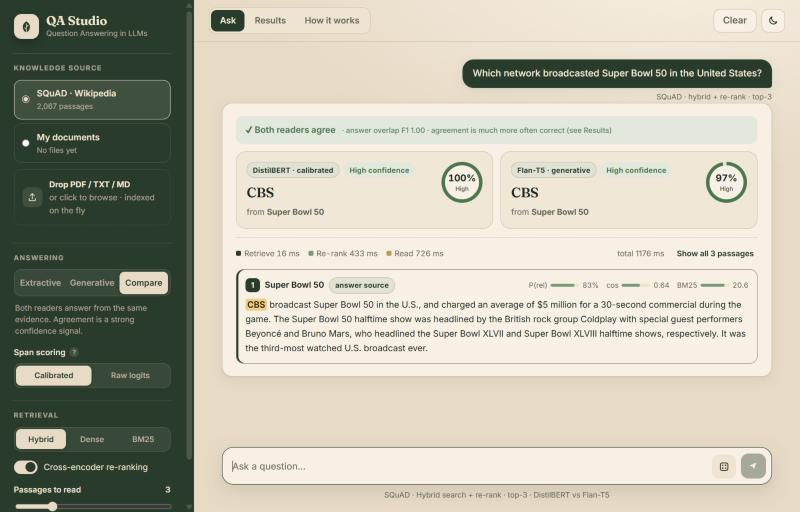

# Question Answering in LLMs

Retrieval-augmented question answering over SQuAD v1.1, built as the completion of the
summer 2025 research internship project *"Question Answering in LLMs"* (SRM University AP,
guide: Dr. M. Krishna Siva Prasad).



It has two layers:

**Core (the internship project, completed):**

* **Retriever**: Sentence-Transformers (`all-MiniLM-L6-v2`) embeddings + FAISS exact cosine search over SQuAD passages
* **Reader 1 (extractive)**: `distilbert-base-cased-distilled-squad`, **fine-tuned by us** on SQuAD with the Hugging Face `Trainer`
* **Reader 2 (generative)**: `google/flan-t5-base`, zero-shot
* **Evaluation**: measured Exact Match, F1, Recall@k and MRR

**Extensions (v2) - each one measured, see [Results v2](#results-v2-extensions):**

| Feature | What it does | Measured effect |
|---|---|---|
| **Hybrid retrieval** | BM25 + dense rankings fused with Reciprocal Rank Fusion ([qa/bm25.py](qa/bm25.py), [qa/search.py](qa/search.py)) | Recall@10 90.9 -> 96.7 |
| **Cross-encoder re-ranking** | `ms-marco-MiniLM-L-6-v2` rescores the top 20 passages | Recall@1 60.7 -> 87.6, Recall@3 79.5 -> 96.1; pipeline F1 65.6 -> 76.4 |
| **Calibrated span scoring** | per-window softmax probabilities x passage probability, instead of raw logits ([qa/readers.py](qa/readers.py)) | +1.8 EM / +1.2 F1 over raw logits on the same passages |
| **Answer confidence** | probability of each answer (span mass for DistilBERT, sequence probability for Flan-T5) | answering the 60 % most-confident questions: EM 87-89 vs 70-76 on all |
| **Dual-reader agreement** | both readers answer from the same evidence; agreement flags trustworthy answers | agree (76 % of questions): EM 84; disagree: EM 25 (DistilBERT) |
| **Bring your own documents** | upload PDF / TXT / MD; chunked and indexed on the fly ([qa/documents.py](qa/documents.py)) | - (no labels) |
| **QA Studio web app** | chat UI with evidence highlighting, confidence rings, compare mode, uploads, live results dashboard, dark mode ([qa/web/](qa/web)) | - |

* **Interfaces**: CLI (`python -m qa.cli`) and a FastAPI service + web app (`uvicorn qa.api:app`)

```
question --> BM25 ---+
                     +-- RRF fusion --> top 20 --> cross-encoder re-rank --> top-k passages (+ P(relevant))
question --> MiniLM -+                                                              |
                                  +-------------------------------------------------+
                                  v                                                 v
                 DistilBERT (ours), calibrated span scoring            Flan-T5 (generation)
                                  +------> answer + confidence + agreement <--------+
```

See [docs/architecture.md](docs/architecture.md) for the full diagram and design notes.

## Results v1 (baseline)

All numbers below were produced by `python -m qa.evaluate` on the machine noted, and are
written into this section automatically. Raw numbers: [results/results.json](results/results.json);
per-question predictions: `results/predictions_*.jsonl`.

<!-- RESULTS:START -->
Measured on `12th Gen Intel(R) Core(TM) i5-1235U, 10 threads` (CPU only, 2026-11-06).

**Retriever** - `sentence-transformers/all-MiniLM-L6-v2` + FAISS `IndexFlatIP` over 2,067 SQuAD v1.1 validation paragraphs, 10,570 questions:

| Recall@1 | Recall@3 | Recall@5 | Recall@10 | Recall@20 | MRR@20 | ms / query |
|---:|---:|---:|---:|---:|---:|---:|
| 62.3 | 80.5 | 86.5 | 91.7 | 95.3 | 72.8 | 2.0 |

**Readers** - SQuAD v1.1 validation, EM / F1 in %:

| Reader | Type | Setting | Questions | EM | F1 | ms / question |
|---|---|---|---:|---:|---:|---:|
| DistilBERT (pretrained, not fine-tuned by us) | extractive | oracle passage | 1,000 | 79.10 | 86.79 | 173 |
| DistilBERT (pretrained, not fine-tuned by us) | extractive | retrieved top-3 | 500 | 57.00 | 65.14 | 558 |
| DistilBERT (fine-tuned by us) | extractive | oracle passage | 1,000 | 77.70 | 86.34 | 190 |
| DistilBERT (fine-tuned by us) | extractive | retrieved top-3 | 500 | 56.60 | 65.58 | 573 |
| Flan-T5 (flan-t5-base, zero-shot) | generative | oracle passage | 1,000 | 84.40 | 91.34 | 723 |
| Flan-T5 (flan-t5-base, zero-shot) | generative | retrieved top-3 | 500 | 62.00 | 68.65 | 1328 |
<!-- RESULTS:END -->

**Fine-tuning run** ([results/training_log.json](results/training_log.json)) - CPU, same machine:

| Train examples (windows) | Epochs / steps | Batch | LR | Time | Train loss | Val. loss before -> after (300 val. questions) |
|---:|---:|---:|---:|---:|---:|---:|
| 3,000 (3,044) | 1 / 191 | 16 | 3e-5 | 37.4 min | 0.579 | 0.992 -> 0.989 |

### What the numbers say

1. **Our fine-tuning keeps the reader where it was rather than improving it.** The starting
   checkpoint was already distilled on SQuAD, so one more epoch on 3,000 SQuAD examples moves
   validation loss only from 0.992 to 0.989. With the gold passage, EM goes 79.1 -> 77.7 and
   F1 86.8 -> 86.3; in the full pipeline, F1 goes 65.1 -> 65.6. 109 of the 1,000 oracle
   predictions changed, mostly in span boundaries. Differences this small are within the noise of
   a 500-1,000-question sample. Clear gains would need a reader that has not already seen SQuAD
   (e.g. `distilbert-base-cased`), or a different domain.
2. **Retrieval is the main bottleneck in the full pipeline.** The gold paragraph is in the top 3
   for 80.5 % of all questions (77.2 % of the 500-question open sample). When it is retrieved,
   the readers score close to their oracle numbers (EM 72.3 base / 71.8 ours / 78.5 Flan-T5).
   When it is missed, EM falls to about 5-6. The remaining ~6-7 EM points come from distractor
   passages.
3. **Flan-T5-base is the stronger reader, but slower.** It leads by about 5 EM / 5 F1 with the gold
   passage and by about 5 EM / 3 F1 in the pipeline, at roughly 4x the CPU latency of DistilBERT
   (723 vs 190 ms per question with one passage). Part of its edge is likely because SQuAD is in
   Flan's instruction-tuning data.
4. **Extractive scores do not compare well across passages.** Raw start+end logits from different
   passages are not calibrated against each other. One example: for "Which NFL team won Super
   Bowl 50?", both DistilBERT readers answer *Carolina Panthers* (the losing team named in the
   same sentence) even with the gold passage alone, while Flan-T5 answers *Denver Broncos*.

## Results v2 (extensions)

Produced by `python -m qa.evaluate_advanced` (raw numbers: [results/advanced.json](results/advanced.json),
per-question predictions with confidences: `results/predictions_advanced.jsonl`). Default pipeline in the
CLI / API / web app = the best measured setting: **hybrid retrieval + re-ranking + calibrated scoring**.

<!-- ADVANCED:START -->
Measured on `12th Gen Intel(R) Core(TM) i5-1235U, 10 threads` (CPU only, 2026-11-06). Retrieval: 1,000 questions; readers: 500 questions (the same seeded sample as the baseline table), top-3 passages.

**A. Retrieval variants**

| Retriever | Recall@1 | Recall@3 | Recall@5 | Recall@10 | MRR@10 | ms / query |
|---|---:|---:|---:|---:|---:|---:|
| Dense (MiniLM + FAISS) | 60.7 | 79.5 | 86.0 | 90.9 | 71.2 | 3 |
| BM25 | 77.5 | 89.2 | 91.9 | 94.4 | 83.8 | 3 |
| Hybrid (RRF dense + BM25) | 70.4 | 87.6 | 93.1 | 96.7 | 80.1 | 3 |
| Hybrid + cross-encoder re-rank (top 20) | 87.6 | 96.1 | 97.5 | 98.3 | 91.9 | 653 |

**B. Full pipeline (retrieve top-3 -> read)**

| Retrieval | Reader | Scoring | EM | F1 | ms / question (read) |
|---|---|---|---:|---:|---:|
| dense | DistilBERT (fine-tuned by us) | raw | 56.60 | 65.58 | 512 |
| hybrid + re-rank | DistilBERT (fine-tuned by us) | raw | 68.00 | 76.35 | 528 |
| hybrid + re-rank | DistilBERT (fine-tuned by us) | calibrated | 69.80 | 77.50 | 515 |
| hybrid + re-rank | Flan-T5 (flan-t5-base) | - | 75.80 | 82.91 | 931 |
| hybrid + re-rank | Ensemble (agreement / confidence) | calibrated | 75.20 | 82.37 | 1446 |

**C. Dual-reader agreement** (calibrated DistilBERT vs Flan-T5 on the same hybrid + re-ranked passages)

| Subset | Questions | DistilBERT EM | Flan-T5 EM |
|---|---:|---:|---:|
| readers agree (answer F1 >= 0.5) | 382 (76.4 %) | 83.8 | 84.6 |
| readers disagree | 118 | 24.6 | 47.5 |

Ensemble (agree -> extractive span, disagree -> the more confident reader): **EM 75.20 / F1 82.37**.

**D. Selective answering** - answer only the most confident questions:

| Coverage | Calibrated DistilBERT EM / F1 | Flan-T5 EM / F1 |
|---:|---:|---:|
| 100 % | 69.8 / 77.5 | 75.8 / 82.9 |
| 80 % | 78.8 / 84.7 | 85.5 / 89.8 |
| 60 % | 87.0 / 89.9 | 89.0 / 91.7 |
| 40 % | 94.0 / 94.6 | 93.5 / 94.6 |
<!-- ADVANCED:END -->

### What the v2 numbers say

1. **Retrieval was the bottleneck, and fixing it is the biggest win.** On SQuAD, BM25 alone beats
   the dense MiniLM retriever (Recall@1 77.5 vs 60.7), because SQuAD questions were written by
   people reading the passage and reuse its words. Hybrid fusion improves deep recall
   (Recall@10 96.7). The cross-encoder then puts the right passage first 87.6 % of the time
   (vs 60.7 %). Our DistilBERT, reading the same 500 questions, goes from F1 65.6 to 76.4, and
   Flan-T5 from 68.7 to 82.9.
2. **Calibrated span scoring helps, modestly.** Turning each window's logits into probabilities
   and weighting by the passage probability gives +1.8 EM / +1.2 F1 over raw logits on identical
   passages. That gain is small for a 500-question sample, so it is a consistent improvement
   rather than a dramatic one. It does not fix every case: for "Who was the Super Bowl 50 MVP?"
   the calibrated reader prefers *Peyton Manning*, from a passage the re-ranker scores highly,
   where raw scoring finds *Von Miller*.
3. **Reader agreement is a very good confidence signal, but not a better answer.** When DistilBERT
   and Flan-T5 agree (76 % of questions) both are right about 84 % of the time (EM). When they
   disagree, DistilBERT drops to 25 % and Flan-T5 to 48 %. The simple ensemble (agree -> span,
   disagree -> more confident reader) scores EM 75.2, about the same as Flan-T5 alone (75.8).
   So agreement is used to *flag* answers in the UI, not to pick them.
4. **Confidence scores are meaningful.** Answering only the 60 % most-confident questions raises
   EM from 69.8 to 87.0 (DistilBERT) and from 75.8 to 89.0 (Flan-T5).
5. **Cost.** Re-ranking adds ~0.65 s per question on this CPU, about the same as the DistilBERT
   read. Flan-T5 reads in ~0.9 s.

**A bug the evaluation caught.** The first evaluation gave Flan-T5 only 22.8 EM with retrieved
passages. With three passages the prompt went past T5's 512-token limit, and right-truncation
cut off the question at the end of the prompt. The prompt builder now trims passages to fit, so
the question is always kept ([qa/readers.py](qa/readers.py)). All numbers above come from the
corrected run.

## Quick start

Requires Python 3.10+ (tested on 3.11, Windows 11, CPU only). No GPU needed.

```bash
git clone https://github.com/gkarthik04/qa-llm.git
```

```bash
cd qa-llm
```

```bash
python -m venv .venv
```

Activate it (`.venv\Scripts\activate` on Windows, `source .venv/bin/activate` on Linux/macOS), then:

```bash
pip install torch --index-url https://download.pytorch.org/whl/cpu
```

```bash
pip install -r requirements.txt
```

(On a machine with an NVIDIA GPU, install the CUDA build of torch from pytorch.org instead of the CPU wheel.)

Run the whole pipeline in order:

```bash
python -m qa.train          # fine-tune DistilBERT -> models/distilbert-squad-finetuned
python -m qa.build_index    # embed 2,067 SQuAD passages -> index/
python -m qa.evaluate       # v1 measurements -> results/ and this README
python -m qa.evaluate_advanced   # v2 features (~45 min on CPU) -> results/advanced.json and this README
pytest -q                   # unit + integration tests
```

Or in one go: `powershell -ExecutionPolicy Bypass -File scripts\run_all.ps1` (Windows) /
`bash scripts/run_all.sh` (Linux/macOS).

Models and the dataset are downloaded from the Hugging Face Hub on first use
(~1.4 GB in total, cached in `~/.cache/huggingface`).

> **Windows long paths.** If the repo sits in a very deep folder and `pip install` fails
> with `ensurepip` / path errors, either enable Windows long-path support or create the
> venv at a short path (e.g. `py -3.11 -m venv C:\venvs\qa-llm`) and use that interpreter.

## Usage

### CLI

```bash
python -m qa.cli ask "Which network broadcasted Super Bowl 50 in the United States?"
python -m qa.cli ask "Who was the Super Bowl 50 MVP?" --reader generative --top-k 5 --show-passages
python -m qa.cli ask "Who was the Super Bowl 50 MVP?" --retrieval dense --no-rerank --scoring raw   # v1 pipeline
python -m qa.cli compare "Which NFL team won Super Bowl 50?"    # both readers + agree/disagree verdict
python -m qa.cli ask "Who was the project guide?" --doc INTERNSHIP_PROJECT_REPORT.pdf             # your own file
python -m qa.cli chat --reader compare                         # interactive loop
python -m qa.cli read -q "What is the capital of France?" -c "France, officially the French Republic, has its capital in Paris."
python -m qa.cli ask "Who designed the Apollo Lunar Module?" --json
```

### Web app (QA Studio) and API

```bash
uvicorn qa.api:app --port 8000
```

Open <http://127.0.0.1:8000> (Swagger UI at <http://127.0.0.1:8000/docs>).

The web app is plain HTML/CSS/JS served by FastAPI ([qa/web/](qa/web)): no Node, no build step. Theme: forest green `#1f3d2b` and sand beige `#e8dcc4`, with Fraunces (headings) and Inter (body) from Google Fonts (falls back to system fonts offline).

* **Ask** - chat-style conversation. Each answer card shows:
  * the answer, a confidence ring and runner-up answers;
  * the evidence passages with the answer highlighted and per-passage relevance, cosine and BM25 bars;
  * a retrieve / re-rank / read latency breakdown.
* **Compare mode** (default) - DistilBERT and Flan-T5 side by side, with a green "agree" or amber
  "disagree" banner.
* **Random SQuAD question** - the dice button picks a real validation question and grades the
  answer against the gold answers (EM / F1).
* **My documents** - drag and drop PDFs or text files; they are chunked, embedded and searchable
  in seconds.
* **Settings** - retrieval method (hybrid / dense / BM25), re-ranking on or off, passages to read
  (1-10), and span scoring (calibrated / raw). They are remembered per browser.
* **Results** - live dashboard of every measured number (charts are rendered from
  `results/*.json`).
* **How it works** - the pipeline explained.
* **Look and access** - light/dark theme, responsive down to phone width, keyboard friendly
  (`/` focuses the question box, Enter sends).

```bash
curl -X POST http://127.0.0.1:8000/api/ask -H "Content-Type: application/json" -d "{\"question\": \"Who was the Super Bowl 50 MVP?\", \"reader\": \"compare\"}"
```

```bash
curl -F "file=@report.pdf" http://127.0.0.1:8000/api/documents
```

| Endpoint | Method | Body / response |
|---|---|---|
| `/api/ask` | POST | `{"question", "reader": "extractive" \| "generative" \| "compare", "top_k": 1-10, "retrieval": "hybrid" \| "dense" \| "bm25", "rerank": bool, "scoring": "calibrated" \| "raw", "corpus": "squad" \| "docs", "gold": [str] (optional)}` -> answer(s), confidence, alternatives, evidence with scores, timings, agreement, EM/F1 vs gold |
| `/api/documents` | POST / GET | upload a PDF/TXT/MD (multipart `file`) / list uploads |
| `/api/documents/{id}` | DELETE | remove an upload |
| `/api/random` | GET | random SQuAD validation question + gold answers |
| `/api/results` | GET | baseline, advanced and training results (JSON) |
| `/api/health` | GET | status, passage count, model names, defaults |
| `/ask`, `/health` | POST / GET | v1 endpoints, kept for compatibility |

Uploaded documents live in server memory (cleared on restart). Limits: 15 MB per file, 3,000
passages in total. Scanned PDFs without a text layer need OCR first.

## Training (fine-tuning DistilBERT)

`python -m qa.train` fine-tunes `distilbert-base-cased-distilled-squad` with the HF `Trainer`
(AdamW, lr 3e-5, batch 16, 10 % warm-up, weight decay 0.01, 384-token windows with stride 128,
windows without the answer labelled with the `[CLS]` position). It logs validation loss on
held-out SQuAD validation questions before and after training and writes
`results/training_log.json`.

| Flag | CPU default | GPU default | Notes |
|---|---|---|---|
| `--train-samples` | 3,000 | 10,000 | random SQuAD train examples (seed 42) |
| `--epochs` | 1 | 3 | 3 epochs x 10k = report setting |
| `--eval-samples` | 300 | 1,000 | validation-loss subset |
| `--max-steps` | - | - | fixed step budget instead of epochs |

**CPU vs. Colab.** The CPU default trains in about 40 minutes on a laptop (37 min measured on an i5-1235U). The internship
report's full setting (10,000 examples x 3 epochs, fp16) is ~10x more compute and should be run
on a GPU: open [notebooks/train_on_colab.ipynb](notebooks/train_on_colab.ipynb) in Google Colab
with a T4 runtime, then unzip the downloaded model into `models/`. Everything else
(index, evaluation, CLI, API) runs comfortably on CPU.

## Evaluation protocol

* **Data**: SQuAD v1.1 (`rajpurkar/squad`). Fine-tuning uses only the *train* split; all
  evaluation uses the *validation* split (10,570 questions, 2,067 unique paragraphs).
* **Retrieval**: every validation question is searched against the 2,067 paragraphs; a hit
  means the question's own paragraph is in the top-k. Reported as Recall@1/3/5/10/20 and MRR@20.
* **Readers**, each in two settings:
  * *oracle passage* - the reader is given the gold paragraph (reading-comprehension ability);
  * *retrieved top-k* - the reader is given the top-3 retrieved paragraphs (the full RAG system).
* **Metrics**: SQuAD v1.1 Exact Match and token-level F1 with the official answer
  normalisation (lower-case, strip punctuation and articles), maximised over the reference
  answers ([qa/metrics.py](qa/metrics.py)).
* **Sample sizes** (CPU): retrieval on all 10,570 questions; readers on a fixed random sample
  of 1,000 (oracle) and 500 (retrieved) questions, seed 42. `--reader-samples 0` uses all questions.

Caveats worth knowing when reading the numbers:

* `distilbert-base-cased-distilled-squad` was already distilled on SQuAD, so further
  fine-tuning on SQuAD starts from a strong model; the comparison "pretrained vs. fine-tuned
  by us" is therefore reported side by side rather than assumed.
* Flan-T5's instruction-tuning mixture includes SQuAD, so its zero-shot score is not a clean
  out-of-domain number.
* The retrieval corpus is the SQuAD validation paragraphs only (closed corpus), not all of Wikipedia.

## Project structure

```
qa-llm/
├── qa/
│   ├── config.py        # model names, paths, sizes (env-overridable: QA_*)
│   ├── data.py          # SQuAD loading, passage corpus
│   ├── retriever.py     # Sentence-Transformers + FAISS index (build / load)
│   ├── bm25.py          # Okapi BM25 (NumPy)
│   ├── search.py        # dense / BM25 / hybrid (RRF) search + cross-encoder re-ranking
│   ├── documents.py     # PDF/TXT/MD upload -> chunks -> on-the-fly index
│   ├── readers.py       # DistilBERT (raw / calibrated scoring) + Flan-T5 readers with confidence
│   ├── pipeline.py      # retrieve -> read, compare() with agreement
│   ├── train.py         # fine-tuning with HF Trainer
│   ├── build_index.py   # build FAISS index
│   ├── evaluate.py      # v1: EM / F1 / Recall@k / MRR, writes results + README table
│   ├── evaluate_advanced.py  # v2: retrieval variants, scoring, agreement, selective answering
│   ├── metrics.py       # SQuAD metrics
│   ├── cli.py           # command-line interface
│   ├── api.py           # FastAPI JSON API, serves the web app
│   └── web/             # QA Studio front end (index.html, styles.css, app.js)
├── tests/               # unit tests (metrics, BM25, chunking, PDF) + pipeline/API integration tests
├── notebooks/train_on_colab.ipynb
├── scripts/run_all.ps1, run_all.sh
├── docs/architecture.md
├── results/             # results.json, advanced.json, training_log.json, predictions
├── requirements.txt
└── README.md
```

`models/` (fine-tuned weights, ~250 MB) and `index/` are generated and git-ignored.

## Configuration

Override any setting with an environment variable, e.g. a larger generator:

```bash
QA_GEN_MODEL=google/flan-t5-large python -m qa.evaluate --readers flan
```

Available: `QA_BASE_READER`, `QA_FINETUNED_READER_DIR`, `QA_GEN_MODEL`, `QA_EMBED_MODEL`,
`QA_RERANK_MODEL`, `QA_DEFAULT_RETRIEVAL`, `QA_DEFAULT_RERANK` (`1`/`0`), `QA_DEFAULT_SCORING`,
`QA_CHUNK_WORDS`, `QA_CHUNK_OVERLAP`, `QA_MAX_UPLOAD_MB`, `QA_MAX_UPLOAD_CHUNKS`,
`QA_INDEX_DIR`, `QA_RESULTS_DIR`, `QA_MAX_LENGTH`, `QA_DOC_STRIDE`, `QA_SEED`.

## Authors

G Sai Karthikeya (AP23110010631), Shaik Sameed (AP23110010598) - Department of CSE, SRM University AP.
