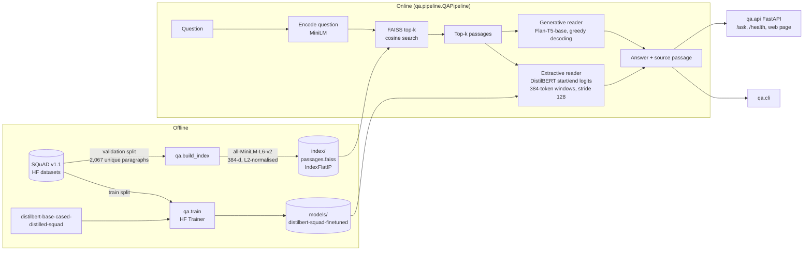

# Architecture

## v2 pipeline (default)

```mermaid
flowchart LR
    Q[Question] --> D[Dense: MiniLM + FAISS]
    Q --> B[BM25]
    D --> F[Reciprocal Rank Fusion<br/>top 20]
    B --> F
    F --> R[Cross-encoder re-rank<br/>ms-marco-MiniLM-L-6-v2]
    R -->|top-k passages + P(relevant)| X[DistilBERT ours<br/>calibrated span scoring]
    R -->|top-k passages| G[Flan-T5-base<br/>sequence probability]
    X --> A[Answer + confidence + evidence]
    G --> A
    X -.compare mode.-> AG{Agree?}
    G -.compare mode.-> AG
    U[Uploaded PDF / TXT / MD] -->|chunk ~120 words, overlap 30| UI[(Per-session dense + BM25 index)]
    UI --> F
```

**Calibrated span scoring.** For window *w* of passage *p*, the reader's start and end logits are
turned into log-probabilities over that window's context tokens. A span's score is
`log P(start) + log P(end) + log P(p | q)`, where `P(p | q)` is a softmax over the cross-encoder
logits of the top-k passages (or over cosine/0.05 without re-ranking). Confidence is the softmax
mass of all candidate spans with the same normalised text.

**Generative confidence.** The product of the probabilities of the tokens Flan-T5 generated (greedy).

**Agreement.** Token-F1 between the two answers >= 0.5.

## v1 pipeline



## Components

| Module | Responsibility |
|---|---|
| `qa/config.py` | Model names, paths, tokenisation sizes (overridable with `QA_*` env vars) |
| `qa/data.py` | Load SQuAD via `datasets`, deduplicate paragraphs into a passage corpus, map questions to gold passage ids |
| `qa/retriever.py` | `DenseRetriever`: Sentence-Transformers encoder + FAISS `IndexFlatIP`; build / save / load / search |
| `qa/bm25.py` | Okapi BM25 (k1 1.5, b 0.75) with precomputed posting weights, NumPy only |
| `qa/search.py` | `SearchEngine`: dense / BM25 / hybrid (RRF, k = 60) search, optional cross-encoder re-ranking, passage priors |
| `qa/documents.py` | PDF/TXT/MD text extraction (pypdf), sentence-aware chunking, in-memory `DocumentStore` with its own `SearchEngine` |
| `qa/readers.py` | `ExtractiveReader` (DistilBERT span scoring across several passages and overflow windows) and `GenerativeReader` (Flan-T5 prompt + generate) with a common `read_batch` interface |
| `qa/pipeline.py` | `QAPipeline.ask()`: retrieve top-k, read, return answer + provenance + latency |
| `qa/train.py` | Fine-tunes DistilBERT on SQuAD train with the HF `Trainer`, logs validation loss before/after |
| `qa/metrics.py` | Official-style SQuAD EM / F1 normalisation, Recall@k, MRR |
| `qa/evaluate.py` | Measures retrieval and both readers (oracle passage vs. retrieved passages), writes `results/` and the README table |
| `qa/evaluate_advanced.py` | Measures retrieval variants, raw vs calibrated scoring, reader agreement and selective answering |
| `qa/cli.py` | `ask`, `compare`, `chat`, `read` commands |
| `qa/api.py` | FastAPI JSON API (`/api/*`) that also serves the web app |
| `qa/web/` | QA Studio front end: `index.html`, `styles.css`, `app.js` (no framework, no build step) |

## Design notes

* **Corpus.** The retrieval corpus is the 2,067 unique paragraphs of the SQuAD v1.1 *validation* split and the evaluation questions come from the same split. This makes Recall@k well defined (every question has exactly one gold paragraph) and keeps indexing fast on CPU. Fine-tuning uses only the *train* split, so no evaluation question is seen in training.
* **Extractive scoring across passages.** Each (question, passage) pair is tokenised into 384-token windows with a 128-token stride. For every window the reader takes the top-20 start and end logits over context tokens, keeps spans with `start <= end` and length <= 30 tokens, and scores a span by `start_logit + end_logit`. The highest-scoring span over all windows of all retrieved passages wins, and the passage it came from is reported as the source.
* **Generative prompt.** Flan-T5 receives `Passage 1..k` followed by the question and is asked for a short phrase copied from the passages. The input limit is 512 tokens. Passages are added in rank order and the last one that fits is trimmed, so the question at the end of the prompt is never cut off (plain truncation used to drop it and cost about 40 EM points in the retrieved setting).
* **Exact search.** `IndexFlatIP` on normalised vectors is exact cosine search. For a few thousand passages a whole query, including encoding, took 2 ms on CPU; an IVF/HNSW index would only be worth it for millions of passages.
